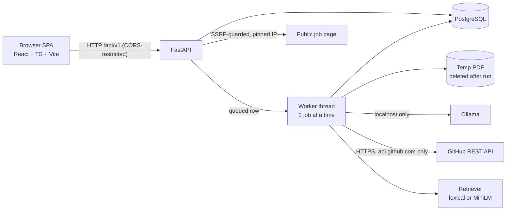

# Architecture

Modular monolith. One FastAPI process hosts the API and a single background worker thread. No Redis/Celery/microservices.

## Backend layout (`backend/app`)
| Path | Responsibility |
|---|---|
| `api/v1/routes.py` | HTTP surface, validation, lifecycle |
| `core/` | settings (env), structured errors |
| `models/`, `db/` | SQLAlchemy models, engine/session |
| `schemas/` | Pydantic response models |
| `services/resume` | PDF validation + text extraction (PyMuPDF) |
| `services/jobs` | safe fetch, HTML→text, requirement extraction |
| `services/github` | bounded REST retrieval with provenance |
| `services/embeddings` | rankers (lexical default; sentence-transformers optional) |
| `services/evidence` | chunking, skill lexicon, rule assessment, **LLM output validation**, advice templates |
| `services/llm` | Ollama client + prompts/schemas |
| `workers/pipeline.py` | pipeline, DB-backed queue, recovery |
| `utils/ssrf.py` | URL/IP validation |

Dependency direction: `api → workers/services → models/db`. Services never import `api`. The browser only talks to the API.
