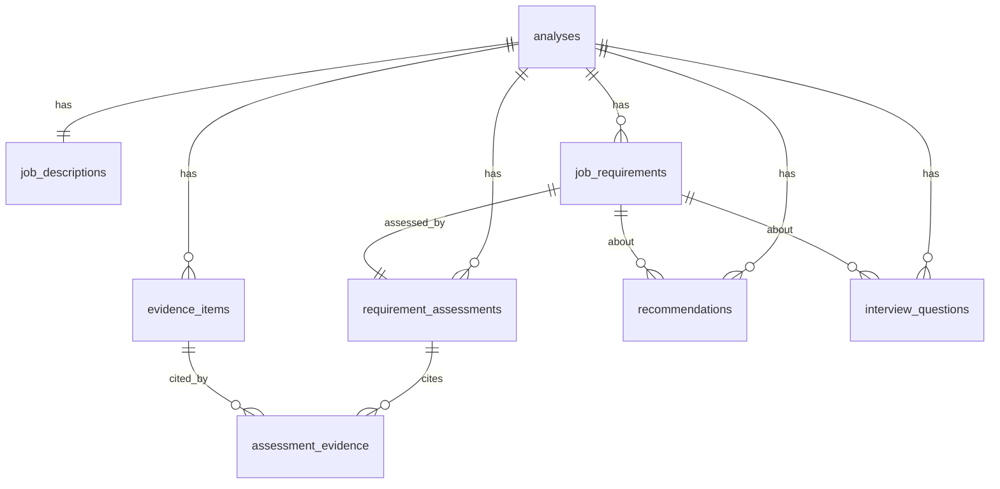

# Database design

All child tables use `ON DELETE CASCADE` from `analyses`, so deleting an analysis removes everything. IDs are 32-char hex strings. Constraints: `CHECK` on analysis status and assessment status values; `UNIQUE(analysis_id, ordinal)` for requirements; `UNIQUE(analysis_id, ref)` for evidence (each passage stored once and linked from every assessment that cites it via `assessment_evidence`, which also holds the verified `quote`). Indexes: `analyses.status`, `analysis_id` on every child, `assessment_evidence.evidence_id`. `requirement_assessments.confidence` exists but is never populated.

## Migrations
`backend/alembic/versions/0001_initial_schema.py` was **autogenerated against PostgreSQL 16.2** and verified: `upgrade head` from an empty database, `alembic check` (no drift), `downgrade base`, `upgrade head` again.
Commands: see `setup-windows.md` §2 and §8 (reset is destructive).

## Roles
`matchlens_owner` runs migrations; `matchlens_app` has DML only (verified: `CREATE TABLE` as the app role is rejected). See `database/init/01-roles.sql`.

## Retention (exactly what is stored)
| Data | Stored? | Until |
|---|---|---|
| Uploaded PDF | temp file in `DATA_DIR/uploads` | removed when processing ends (success, failure, cancel); orphans swept at startup |
| Resume filename and page count | yes | analysis deleted |
| Resume text | only passages cited as evidence (whitespace-normalized) | analysis deleted |
| Job text (pasted/fetched/manual), URL, title, company | yes | analysis deleted |
| Requirements, findings, recommendations, questions | yes | analysis deleted |
| GitHub snippets cited as evidence + provenance | yes | analysis deleted |
| Logs | no resume/job/repo text; httpx URL logging disabled | — |
There is **no automatic expiry** of completed analyses; the user deletes them. Browser `sessionStorage` keeps only the analysis id until the tab closes. Backups/WAL of your PostgreSQL are outside this app's control.
